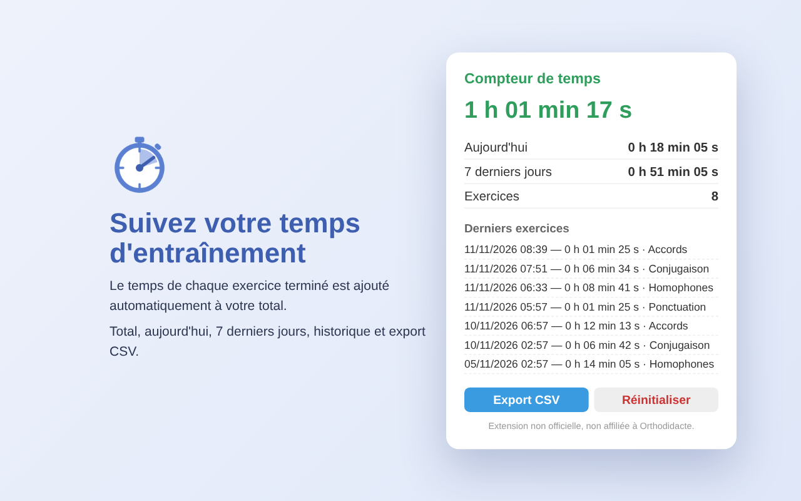

# Compteur de temps pour Orthodidacte (non officiel)

Extension Chrome / Chromium (Brave, Edge, Opera, Vivaldi…) qui additionne automatiquement le temps passé sur chaque exercice [Orthodidacte](https://www.orthodidacte.com) terminé.

> Projet indépendant et non officiel, ni affilié à Orthodidacte ni approuvé par Orthodidacte.



## Fonctionnalités

- Détection automatique de la fin d'un exercice et lecture du « Temps écoulé »
- Temps total, du jour et des 7 derniers jours, nombre d'exercices
- Historique des derniers exercices, avec leur thème
- Export CSV, remise à zéro
- Un même résultat n'est jamais compté deux fois (rechargement, nouvel affichage de la page)
- Données stockées uniquement dans le navigateur (`chrome.storage.local`), rien n'est envoyé nulle part

## Installation

**Depuis le Chrome Web Store :** _(lien à ajouter une fois l'extension publiée)_

**Depuis les sources :**
1. Téléchargez ce dépôt (bouton **Code → Download ZIP**) et dézippez-le.
2. Ouvrez `chrome://extensions` (ou `brave://extensions`, `edge://extensions`…).
3. Activez le **Mode développeur**.
4. Cliquez sur **Charger l'extension non empaquetée** et sélectionnez le dossier `extension/`.

## Fonctionnement technique

Orthodidacte est une application monopage (Aurelia) : l'URL ne change pas toujours entre les écrans. Le script `extension/content.js` s'exécute donc sur `*.orthodidacte.com` et surveille le DOM avec un `MutationObserver`.

Quand un élément affiche un temps au format `X h YY min ZZ s`, l'extension considère que l'exercice est terminé. Elle cherche cet élément de deux façons :
1. par sa classe CSS, qui contient `exerciseDetail-block-value` ;
2. à défaut, parmi les éléments sans enfant d'une page qui contient le texte « Temps écoulé ».

L'élément trouvé est marqué (`data-odt-counted`). Une empreinte (temps + thème + type) empêche aussi de recompter le même résultat dans les 5 minutes.

Les logs de diagnostic sont visibles dans la console de la page, avec le préfixe `[ODT]`.

### Si l'extension ne détecte plus rien

Le plus probable est qu'Orthodidacte a modifié son interface. À vérifier, dans l'ordre :
- Les lignes `[ODT] script chargé…` apparaissent-elles dans la console ? Si non, le domaine a peut-être changé : mettez à jour `matches` dans `extension/manifest.json`.
- Le temps est-il toujours affiché au format `0 h 01 min 25 s` ? Sinon, adaptez `TIME_RE` dans `content.js`.
- La classe CSS ou le libellé « Temps écoulé » existent-ils toujours ? Sinon, adaptez `findTimeElements()`.

## Structure

```
extension/
  manifest.json   déclaration de l'extension (Manifest V3)
  content.js      détection du temps sur orthodidacte.com
  popup.html/js   fenêtre affichée en cliquant sur l'icône
  icons/          icônes PNG + source SVG
docs/             captures d'écran
```

## Publier une nouvelle version

1. Augmentez `version` dans `extension/manifest.json`.
2. Zippez le dossier `extension/`, sans `icons/icon.svg`.
3. Envoyez le zip dans l'onglet « Package » du tableau de bord développeur du Chrome Web Store.

## Contribuer

Les issues et pull requests sont les bienvenues. Ce projet peut aussi être librement repris et republié (voir la licence) si l'original n'est plus maintenu.

## Licence

[MIT](LICENSE)
